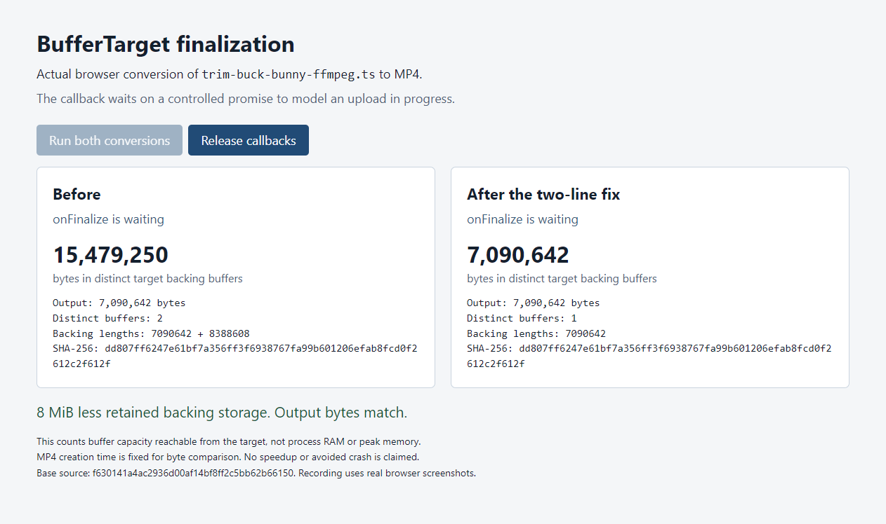

# BufferTarget finalization evidence

[Watch the browser recording](buffer-target-demo.mp4).



The recording shows real Chrome conversions of `test/public/trim-buck-bunny-ffmpeg.ts` to MP4. A controlled promise holds `onFinalize` open to model an upload wait. No network upload occurs. The video uses actual viewport screenshots captured at about 5 fps, with their intervals preserved during H.264 encoding. It is 15.32 seconds long and has no audio.

Both conversions produce the same 7,090,642-byte file. While the callbacks wait, the original target retains 15,479,250 bytes in two distinct backing buffers. The patched target retains one 7,090,642-byte buffer, a reduction of 8 MiB. Releasing the callbacks completes both conversions.

This measures backing buffers reachable from the target, not process RAM or peak memory. It does not establish a speedup or an avoided crash. The final copy remains, and actual collection timing is up to the runtime. Output creation time is fixed during construction to make MP4 metadata deterministic.

## Reproduce

The baseline is `f630141a4ac2936d00af14bf8ff2c5bb62b66150`. The patched commit is `8ab42a1139fa426da363f3b2b390bdf4923f6fac`. Keep this evidence directory outside both source checkouts.

Use Node and dependencies installed for the same operating system. Windows Node cannot use an esbuild binary installed inside WSL.

```sh
git clone https://github.com/Vanilagy/mediabunny.git baseline
git -C baseline checkout f630141a4ac2936d00af14bf8ff2c5bb62b66150
git clone --branch codex/buffer-target-finalization https://github.com/meiiie/mediabunny.git patched
git -C patched checkout 8ab42a1139fa426da363f3b2b390bdf4923f6fac
npm --prefix baseline ci
npm --prefix patched ci
node reproduce.cjs ./baseline ./patched
node serve-demo.cjs ./baseline ./patched
```

The first script builds each actual source version in a separate Node process, compares every output byte, and prints the retained capacities inside the callback and after finalization. It deletes its generated temporary bundles and outputs. `result.json` records a successful run on Node 24.19.0.

For the browser demo, open the printed localhost address in Chrome. Click **Run both conversions**, inspect the waiting callbacks, then click **Release callbacks**. Stop the server with Ctrl+C. Generated browser bundles stay in `.demo-assets/`. The server checks the two source hashes and the fixture hash before starting.

`recording.json` records the capture method, Chrome version and source, fixture, output and video hashes. `demo.js` and `index.html` are the page shown in the recording. The private capture runner and unrelated desktop content are not included.

## Related validation

The exact patch passed 99 relevant Node tests, typecheck, changed-file lint and 112 assertions in a separate Chrome lifecycle check. Earlier measurements alternated baseline and candidate across two real fixtures and both regular and fragmented MP4, with 40 recorded conversions and 16 warmups. Their output bytes and media metadata matched. A separate heap snapshot after forced GC showed the old 8 MiB allocation only in the baseline.

The complete suite did not pass in the baseline environment. Windows had hardware encoder failures and timeouts; WSL suffered a worker termination of unresolved cause. The scoped passing checks are not a claim that the complete suite is green. Older-browser behavior was simulated through the fixed-buffer path in a modern runtime, not tested in every browser.

This is a proactive contribution. Codex prepared the patch, scripts, description and recording. No production incident caused by this retention is being claimed. These evidence files live on a separate fork branch and are not part of the proposed library diff.
